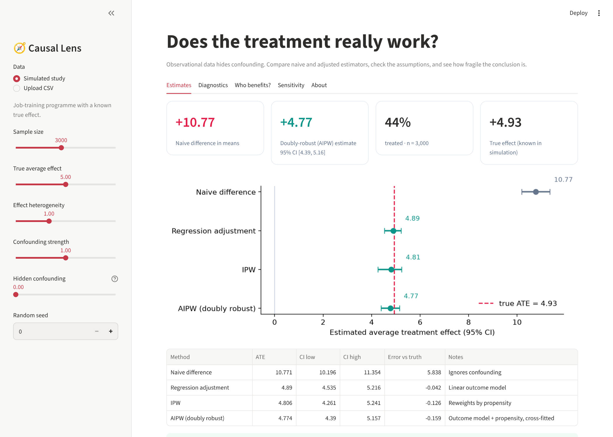
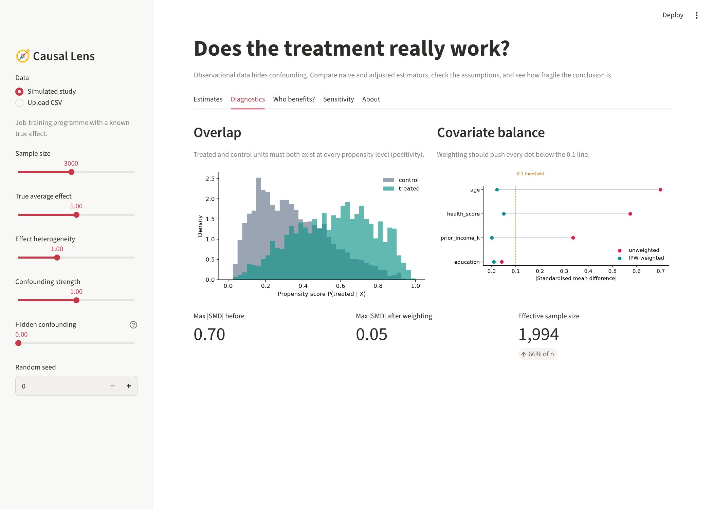
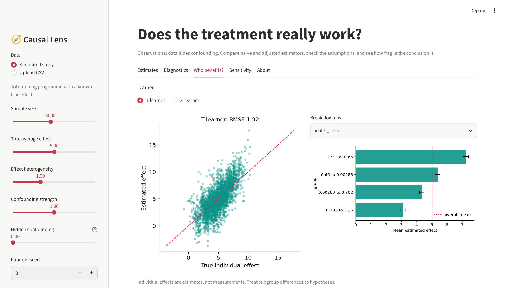
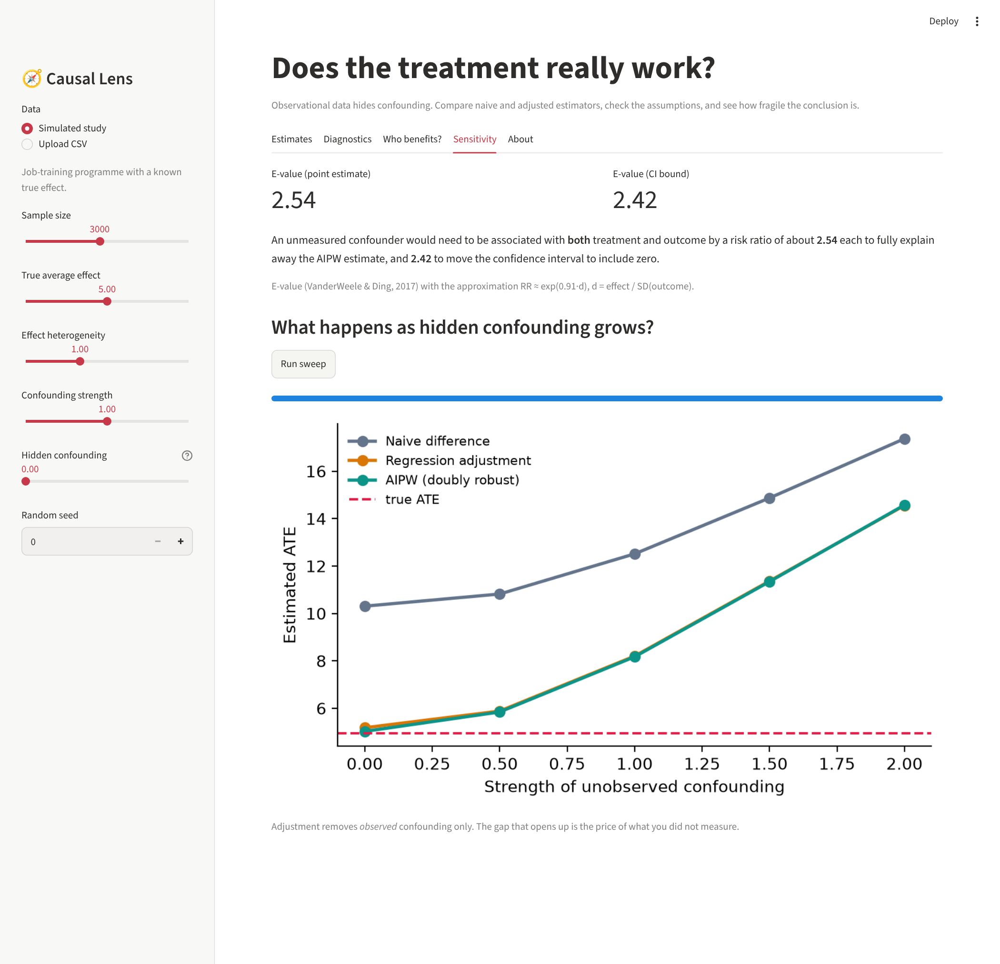

# 🧭 Causal Lens


**Does a treatment really work, or do the people who chose it just differ?**
Causal Lens estimates the causal effect of a binary treatment from observational data, checks whether the assumptions are believable, and shows how fragile the conclusion is.



## Why this project

Correlation is not causation, and the naive comparison can be wildly wrong. In the built-in simulated study the true effect of a training programme is **+4.9**, the naive comparison says **+10.8**, and the adjusted estimators land within 0.2 of the truth. Because the truth is known in simulation, you can see exactly when each method works and when it breaks.

## Features

- **Four estimators** with 95% confidence intervals: naive difference, regression adjustment, inverse-probability weighting (IPW), and cross-fitted doubly-robust **AIPW**.
- **Diagnostics:** propensity overlap, covariate balance (Love plot, standardised mean differences), effective sample size, extreme-weight warning.
- **Heterogeneous effects (CATE):** T-learner and X-learner, with subgroup breakdowns and a comparison to the true individual effects.
- **Sensitivity analysis:** E-value for unmeasured confounding, plus a sweep that shows adjusted estimates drifting away from the truth as hidden confounding grows.
- **Bring your own data:** upload a CSV, map treatment / outcome / covariates, and get the same analysis.
- **Tested:** 15 unit tests check that estimators recover the truth, intervals cover it, weighting improves balance and E-values match published values. CI runs on Python 3.10-3.12.

| Diagnostics | Who benefits? | Sensitivity |
|---|---|---|
|  |  |  |

## Quick start

```bash
git clone https://github.com/matiur-rahman1/causal-lens.git
cd causal-lens

python -m venv .venv
# Windows:  .venv\Scripts\activate
# macOS/Linux:  source .venv/bin/activate

pip install -r requirements.txt
streamlit run app.py
pytest -q
```

Use it as a library:

```python
from causal_lens import simulate, estimate_all

data = simulate(n=3000, effect=5.0, confounding=1.0, seed=0)
for e in estimate_all(data):
    print(f"{e.name:24s} {e.ate:6.2f}  [{e.low:.2f}, {e.high:.2f}]")
print("true ATE:", data.true_ate)
```

Try your own data with `data/sample_observational.csv` (columns `age, health_score, prior_income_k, education, training, earnings_k`; treatment = `training`, outcome = `earnings_k`).

## Methods

| Method | Idea | Weakness |
|---|---|---|
| Naive difference | Compare group means | Biased by confounding |
| Regression adjustment | Linear outcome model with covariates | Wrong when the outcome is non-linear |
| IPW (Hajek) | Weight by 1/propensity to mimic a randomised trial; bootstrap CI | Unstable with extreme weights |
| AIPW | Outcome model **and** propensity model, 5-fold cross-fitting; correct if either model is right; influence-function CI | Needs overlap |
| T-/X-learner | Estimate individual effects with gradient boosting | No confidence intervals here; read as hypotheses |

Propensity scores are clipped to [0.02, 0.98]. The E-value uses the approximation RR ≈ exp(0.91·d) for continuous outcomes (VanderWeele & Ding, 2017).

## Project layout

```
.
├── app.py                    # Streamlit app
├── causal_lens/
│   ├── data.py               # simulator with ground truth, CSV loader
│   ├── estimators.py         # naive, OLS, IPW, AIPW, T-/X-learner
│   ├── diagnostics.py        # propensity, SMD, ESS, E-value
│   └── plots.py              # matplotlib figures
├── tests/                    # pytest suite
├── data/sample_observational.csv
├── docs/                     # screenshots
└── .github/workflows/ci.yml  # GitHub Actions
```

## Limitations

- Causal conclusions rest on **untestable assumptions**: no unmeasured confounding, positivity, consistency. The diagnostics can only reveal violations of the testable parts.
- Binary treatment and continuous outcome only.
- The simulator is stylised. Real data needs domain knowledge to choose covariates (never adjust for variables affected by the treatment).

## Ideas for next steps

- Matching and entropy balancing.
- Confidence intervals for CATE (causal forests, conformal).
- Instrumental variables and difference-in-differences.
- Deploy on Streamlit Community Cloud.

## References

- Robins, Rotnitzky & Zhao (1994). Estimation of regression coefficients when some regressors are not always observed.
- Chernozhukov et al. (2018). Double/debiased machine learning for treatment and structural parameters.
- Künzel et al. (2019). Metalearners for estimating heterogeneous treatment effects using machine learning.
- VanderWeele & Ding (2017). Sensitivity analysis in observational research: introducing the E-value.

## License

MIT
